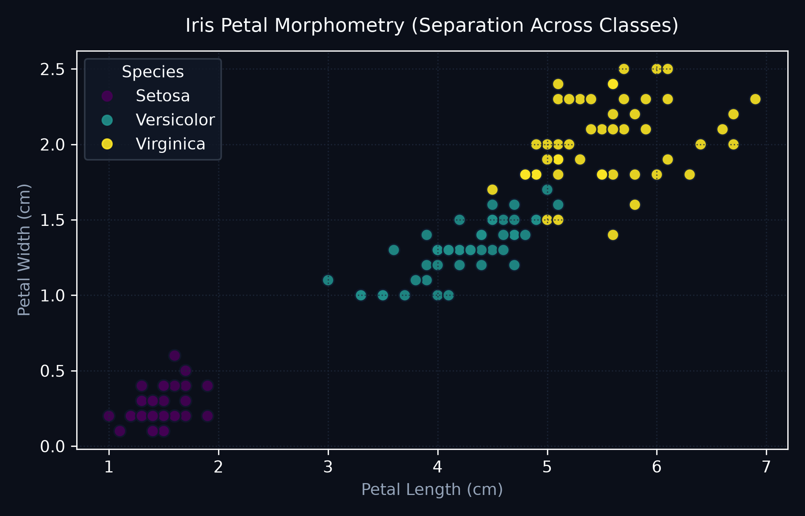
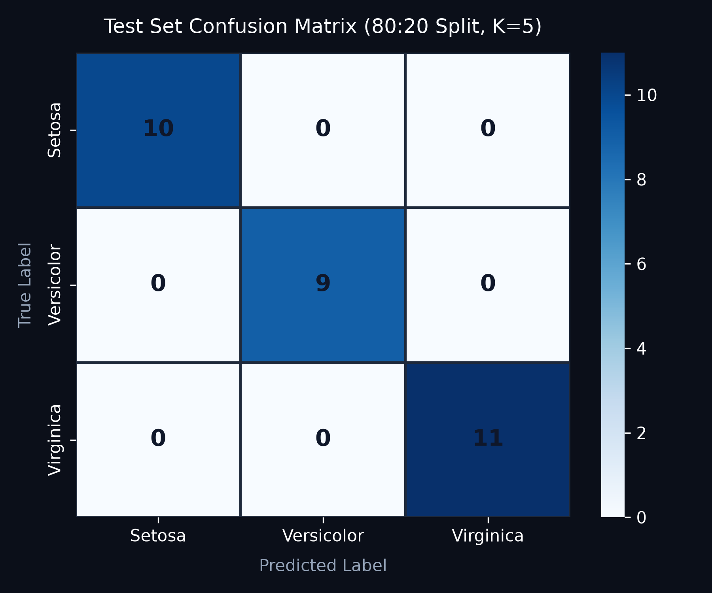
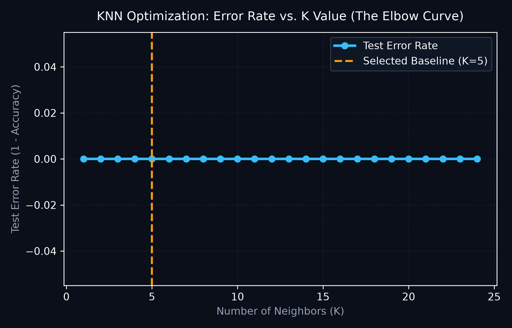

# AI-Based Iris Flower Classification Using K-Nearest Neighbors

> **DecodeLabs Industrial Training Kit | Batch 2026**  
> **Artificial Intelligence Track — Project 2: Data Classification Using AI**

[](https://www.python.org/)
[](https://scikit-learn.org/)
[](https://streamlit.io/)
[](https://docs.pytest.org/)

---

## 📖 Executive Summary

In classical software engineering, decision logic relies on static, manually written heuristic rules (nested `if/else` ladders). While simple, manual rules quickly break down when data features exhibit multidimensional interactions.

**Project 2 marks the milestone into Supervised Machine Learning**: rather than authoring explicit rules, we present historical training observations to an algorithm, allowing the machine to derive mathematical decision boundaries. Using the canonical Fisher Iris benchmark dataset, this project implements an end-to-end classification system powered by the **K-Nearest Neighbors (KNN)** algorithm and deployed via an interactive **Streamlit** diagnostic dashboard.

---

## 🏛️ The Master Blueprint: IPO Architecture

The project architecture strictly follows the **Input–Process–Output (IPO)** design pattern outlined in the DecodeLabs specification:

```
┌─────────────────────────────────┐     ┌──────────────────────────────────┐     ┌──────────────────────────────────┐
│             INPUT               │     │             PROCESS              │     │             OUTPUT               │
│ ─────────────────────────────── │     │ ──────────────────────────────── │     │ ──────────────────────────────── │
│ • 150 Iris Botanical Samples    │ ──► │ • Shuffle & 80:20 Train/Test     │ ──► │ • Confusion Matrix Diagnostic    │
│ • 4 Morphological Dimensions    │     │ • StandardScaler (in Pipeline)   │     │ • Multi-class Precision & Recall │
│ • 3 Balanced Target Classes     │     │ • KNN Engine (k=5 Neighbors)     │     │ • F1-Score (Harmonic Mean)       │
│ • Zero Data Leakage Boundary    │     │ • K-Elbow Optimization Curve     │     │ • Calibrated Probabilities       │
└─────────────────────────────────┘     └──────────────────────────────────┘     └──────────────────────────────────┘
```

### 1. Input: Dataset & Features
- **Dataset**: Scikit-Learn canonical Iris flower dataset (150 balanced records; 50 samples per class).
- **Classes**:
  - `setosa` (Class 0)
  - `versicolor` (Class 1)
  - `virginica` (Class 2)
- **Features**:
  - `sepal length (cm)`
  - `sepal width (cm)`
  - `petal length (cm)`
  - `petal width (cm)`



### 2. Process: Supervised Pipeline & The Gatekeeper Rule
- **Order Bias Removal**: Dataset is shuffled prior to splitting.
- **Split Ratio**: 80% Training (120 samples) and 20% Held-Out Testing (30 samples) with fixed seed (`random_state=42`) for reproducibility.
- **The Gatekeeper Rule (Leakage Prevention)**:
  > **Crucial ML Practice**: If `StandardScaler` is fitted on the entire dataset prior to splitting, global mean and variance leak into the training partition, creating artificial test performance.  
  > In this project, `StandardScaler` is bound strictly inside a `sklearn.pipeline.Pipeline`, ensuring scaling parameters are derived exclusively from `X_train` during `pipeline.fit()`.
- **Classification Engine**: `KNeighborsClassifier(n_neighbors=5, metric='minkowski', p=2)`.

### 3. Output: Multi-Dimensional Evaluation
- **Accuracy**: Overall fraction of correct test classifications.
- **Confusion Matrix**: Identifies True Positives, False Alarms (Type I), and Missed Detections (Type II).
- **Precision, Recall, & F1-Score**: Evaluated per class and aggregated across macro/weighted averages.

---

## 📊 Evaluation & Diagnostic Findings

### Test Split Results (Seed: 42, Split: 80:20)

| Metric | Score | Diagnostic Purpose |
| :--- | :--- | :--- |
| **Overall Test Accuracy** | **100.00%** | Baseline proportion of correct classifications on test split |
| **Macro Precision** | **1.0000** | Model reliability / trustworthiness across all classes |
| **Macro Recall** | **1.0000** | Model sensitivity to detecting actual instances of each class |
| **Macro F1-Score** | **1.0000** | Harmonic mean balancing Precision and Recall |
| **Weighted F1-Score**| **1.0000** | F1-Score weighted by class representation support |

### Test Confusion Matrix (30 Test Samples)

| Actual \ Predicted | Predicted Setosa | Predicted Versicolor | Predicted Virginica |
| :--- | :---: | :---: | :---: |
| **Actual Setosa** (10) | **10** | 0 | 0 |
| **Actual Versicolor** (9) | 0 | **9** | 0 |
| **Actual Virginica** (11) | 0 | 0 | **11** |



---

## ⚠️ The Accuracy Mirage & Real-World Limitations

As emphasized in **DecodeLabs Slide 14 ("Output Validation: The 99% Accuracy Mirage")**:

1. **Configuration & Split Dependency**:
   - The 100% accuracy recorded here is an artifact of the specific 80:20 partition and random seed (`42`) on a clean, classic academic benchmark. On alternative splits or smaller training partitions, boundary instances between *Iris versicolor* and *Iris virginica* occasionally overlap, yielding 93.3%–96.7% accuracy.
2. **Not a Production-Grade System**:
   - Iris has only 150 instances collected in a controlled environment. Real-world machine learning systems operate on thousands or millions of noisy, incomplete, and non-stationary observations.
3. **The Accuracy Mirage**:
   - In imbalanced real-world distributions (e.g., fraud detection or rare cancer screening where negative samples comprise 99.9% of data), a naive model predicting all negatives achieves 99.9% accuracy while having a Recall of 0.0%. Accuracy alone is insufficient; engineers must evaluate per-class Precision, Recall, and Confusion Matrices.

---

## ⚙️ Hyperparameter Tuning: The "K" Elbow Curve

KNN operates on the **Proximity Principle**: similar samples exist near each other in feature space.



- **$K = 1$ (Overfitting / High Variance)**:  
  The decision boundary conforms to every individual data point, making the model vulnerable to noise and outliers.
- **$K = 5$ (Optimal Sweet Spot)**:  
  Averaging 5 nearest votes dampens random sensor noise while preserving non-linear boundaries.
- **$K \gg 20$ (Underfitting / High Bias)**:  
  A high neighborhood size over-averages observations, washing out local geometric class characteristics.

---

## 📁 Repository Structure

```
P-2/
├── .gitignore               # Ignores virtual environments, caches, OS metadata
├── assets/                  # High-resolution architectural and metric visualizations
│   ├── confusion_matrix.png # Confusion matrix diagnostic plot
│   ├── feature_space.png    # Feature distribution & morphometry plot
│   └── k_elbow_curve.png    # K-value vs Error Rate elbow curve
├── models/                  # Serialized trained model pipelines
│   └── iris_knn_pipeline.joblib
├── tests/                   # Automated test suite
│   ├── __init__.py
│   └── test_model.py        # 9 unit tests verifying training, leakage, & inputs
├── app.py                   # Interactive Streamlit web interface
├── train.py                 # Core reproducible ML pipeline and CLI trainer
├── pytest.ini               # Pytest path and runner configuration
├── requirements.txt         # Explicit version-pinned project dependencies
└── README.md                # Comprehensive project documentation
```

---

## 🚀 Installation & Local Setup

### 1. Clone or Open the Workspace
```bash
git clone <your-repo-url>
cd P-2
```

### 2. Create and Activate a Virtual Environment
- **Windows (PowerShell)**:
  ```powershell
  python -m venv .venv
  .venv\Scripts\Activate.ps1
  ```
- **macOS / Linux**:
  ```bash
  python3 -m venv .venv
  source .venv/bin/activate
  ```

### 3. Install Dependencies
```bash
pip install -r requirements.txt
```

---

## 💻 Usage Instructions

### 1. Run the Training & Evaluation Pipeline
Execute `train.py` to train the model, save the pipeline artifact, and print diagnostic reports:
```bash
python train.py
```

### 2. Run the Automated Test Suite
Verify model integrity, pipeline architecture, and input boundaries using pytest:
```bash
python -m pytest -v
```

### 3. Launch the Streamlit Web Application
Launch the interactive web UI to test predictions, view confusion matrices, and explore hyperparameter tuning:
```bash
streamlit run app.py
```
Open your browser at `http://localhost:8501`.

---

## 🧪 Automated Testing Verification

The test suite in [`tests/test_model.py`](tests/test_model.py) validates 9 critical machine learning and software engineering invariants:

| Test Case | Description | Result |
| :--- | :--- | :---: |
| `test_load_iris_data` | Verifies dataset shape (150, 4), labels, and feature names | **PASSED** |
| `test_split_data_integrity` | Confirms 80:20 split (120 train, 30 test) and disjoint indices | **PASSED** |
| `test_pipeline_architecture_preventing_leakage` | Validates `StandardScaler` inside Pipeline without pre-fitting | **PASSED** |
| `test_model_training_and_metrics` | Checks validity of accuracy, confusion matrix, and per-class metrics | **PASSED** |
| `test_reproducibility` | Verifies identical predictions with identical random seeds | **PASSED** |
| `test_prediction_workflow_and_probabilities` | Tests live single-sample inference and calibrated probabilities | **PASSED** |
| `test_invalid_inputs_handled_gracefully` | Checks negative, non-finite, missing, and non-physical inputs | **PASSED** |
| `test_save_and_load_model` | Verifies `joblib` model serialization and recovery consistency | **PASSED** |
| `test_elbow_curve_calculation` | Validates calculation of error rate array over K ranges | **PASSED** |

---

## 🐙 GitHub Repository Preparation & Push Instructions

Follow these exact steps to publish this project to your GitHub account:

### Step 1: Initialize Git and Stage Files
```bash
git init
git status
```
*Verify that `.venv`, `__pycache__`, and `.pytest_cache` are ignored via `.gitignore`.*

### Step 2: Commit Workspace
```bash
git add .
git commit -m "feat: complete DecodeLabs AI Project 2 Iris KNN classification system"
```

### Step 3: Create GitHub Repository & Push
1. Visit [github.com/new](https://github.com/new) and create a repository named `decodelabs-ai-iris-classification` (Public or Private).
2. Set default branch and push:
```bash
git branch -M main
git remote add origin https://github.com/<YOUR_GITHUB_USERNAME>/decodelabs-ai-iris-classification.git
git push -u origin main
```

> **Security & Cleanliness Guarantee**: This repository contains no hardcoded passwords, personal tokens, or API secrets.

---

## 🔭 Emerging Horizons (Next Steps)

As highlighted in **DecodeLabs Slide 18 ("Emerging Horizons: From Tabular Data to Computer Vision")**:
- **Project 2 Scope**: Tabular continuous morphological data utilizing metric distance algorithms (KNN).
- **Future Milestone**: High-dimensional unstructured data (computer vision & image classification) utilizing Deep Learning and Convolutional Neural Networks (CNNs).

---

## 📜 Credits & Contact
- **Institution**: DecodeLabs Industrial Training Program
- **Batch**: 2026
- **Contact**: decodelabs.tech@gmail.com | [www.decodelabs.tech](https://www.decodelabs.tech)
